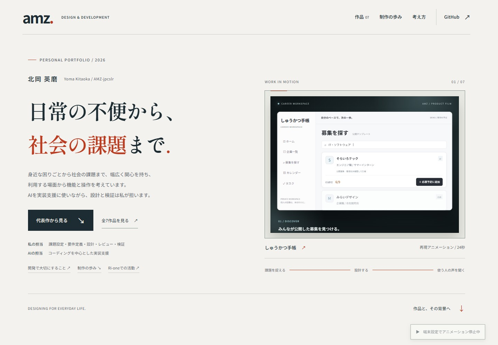
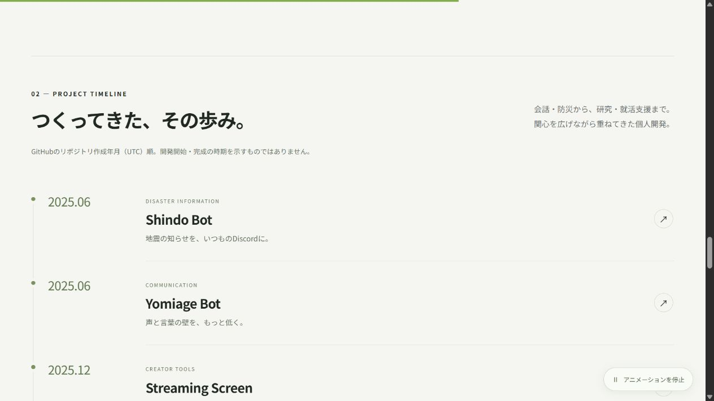
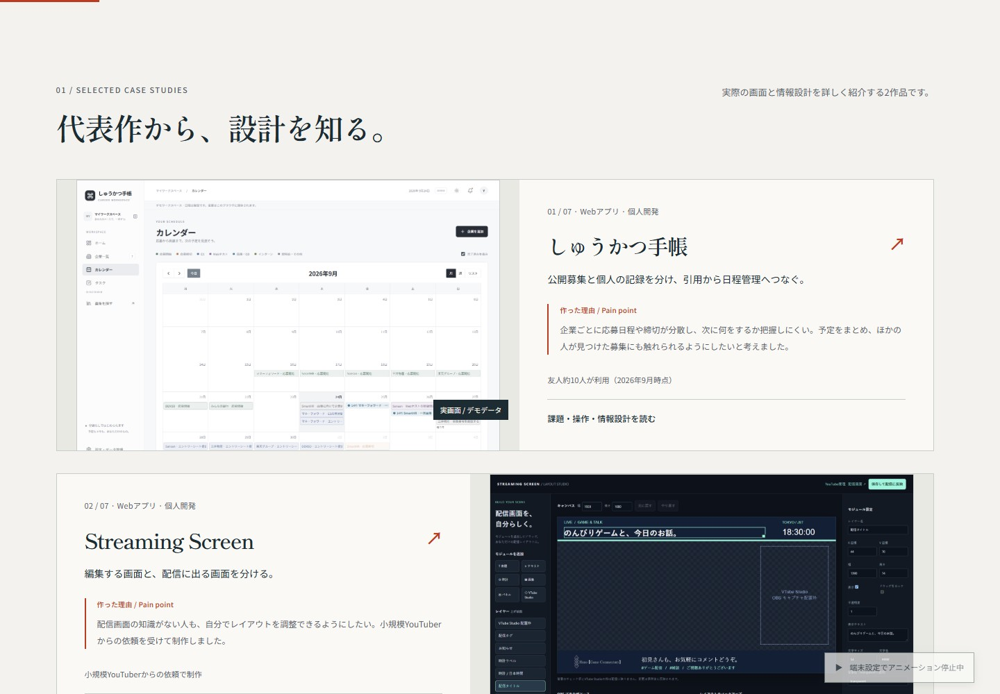

# Kitaoka Yoma / AMZ — Notes & Works

社会や身近な問題に取り組む、北岡英磨の個人開発と研究の記録です。

[公開サイト](https://portfolio-amz-jpcslr.vercel.app/) · [作品一覧](https://portfolio-amz-jpcslr.vercel.app/#works) · [開発記録](https://portfolio-amz-jpcslr.vercel.app/#records) · [GitHub](https://github.com/AMZ-jpcslr)

## サイトの構成

- 本の背表紙から8作品のプレビューと詳細へ移動します。
- 詳細では目的・きっかけ・アプローチ・結果と現状、担当とAIの活用を紹介します。
- リポジトリの作成記録はノートのタブで選び、左のノートで概要と機能の再現イメージを確認できます。タブは右端に並び、ノートの右端が浮く向きで切り替わります。
- 最近の公開GitHub更新は、1件ずつ独立した付箋として表示します。新しい記録が上です。
- 理念は「課題を理解する」「試して改善する」「伝え方と研究姿勢」の3区分・9項目です。行動指針と、作品ごとの実施状況を区別しています。

動画8本と年表の機能画像は**動作イメージ（再現映像／再現イメージ）**です。実アプリの録画や実際の災害情報ではありません。作品ごとの注記を表示しています。プレビューは消音・ループで、独自の一時停止ボタンがあります。サイトの操作音はありません。

採用担当の方へのメッセージに続き、ページ末尾の本棚でサイト内を検索できます。作品に加え、自己紹介・理念・活動・作成記録・最近の開発記録・メッセージの見出しや本文、関連語をローカルで照合し、本が棚から出てくる短い演出とともに結果を表示します。検索結果は演出を待たずに開けます。外部LLM/APIへ検索語を送りません。

固定メニューは作品・記録・理念・メッセージ・検索・GitHubへの移動に対応し、狭い画面では開閉できます。キーボード・タッチ操作、動きを減らす設定に対応します。区画の短い描画と付箋の貼り付けは、画面内に十分入ってから始まり、同じ付箋を小さなスクロールのたびに貼り直しません。

作品の現在地は、作品一覧・詳細・検索結果のラベルで示します。公開・運用・試作・研究を区別し、現在の動作が確認できていないBotは「稼働確認中」としています。再現映像は稼働の証拠として扱いません。

## 作成の記録

GitHubの `created_at` を基準とした**日本時間（Asia/Tokyo）の作成年月**です。開発開始・完成・リリース日ではありません。同月内も実際のタイムスタンプ順で並べます。

| 作成年月（日本時間） | 作品 |
| --- | --- |
| 2025.06 | [Shindo Bot](https://github.com/AMZ-jpcslr/Shindo_Discord_Bot) |
| 2025.07 | [Yomiage Bot](https://github.com/AMZ-jpcslr/Yomiage_Discord_Bot) |
| 2025.12 | [Streaming Screen](https://github.com/AMZ-jpcslr/Streaming-Screen) |
| 2026.01 | [SSL Robot AI](https://github.com/AMZ-jpcslr/SSL-DEMO) |
| 2026.05 | [Inspection Proxy](https://github.com/AMZ-jpcslr/ssl-inspection-prodxy) |
| 2026.09 | [Artificial Moral Architecture](https://github.com/AMZ-jpcslr/Artificial-Moral-Architecture) |
| 2026.09 | [しゅうかつ手帳](https://github.com/AMZ-jpcslr/Syukatu-Note) |
| 2026.10 | [まにあう](https://github.com/AMZ-jpcslr/train_time) |

Yomiage Botの作成日時は `2025-06-30T15:01:25Z` のため、日本時間では7月です。日付が月境界をまたぐ場合も表示を変換し、年月しか分からない資料に日単位の精度を追加しません。

## 公開GitHub更新の取得

対象は本人 `AMZ-jpcslr` と紹介している8作品の公開イベントだけです。各付箋にイベント日時と関連するGitHubリンクがあります。pushをリリースとは表示しません。最終取得日時も日本時間で表示します。

認証なしの公開APIを必要時に取得し、15分のクールダウンを設けています。利用上限・通信失敗時は最終取得日付きの保存データを表示します。APIの反映には遅延があり、完全な活動履歴ではありません。認証情報や非公開活動は使いません。

## 開発と確認

Node.js 22以上を使用します。

```sh
npm run build
npm run check
npm run dev
```

開発サーバーの既定は `http://127.0.0.1:4173/`。`site/` が現行画面のソース、`dist/` が公開出力です。`npm run build` は現行の入口と8つの詳細ページ・素材を `dist/` に反映します。Vercelは既存設定の `dist` を配信します。

`scripts/check-site.mjs` は現行8作品・出力の一致・日時変換・公開データの範囲を確認し、`scripts/check-legacy.mjs` は保持した既存7作品の資料・動画素材を確認します。旧入口は検証用の `scripts/fixtures/legacy-index.html` に保存し、公開の入口には使いません。

本文データは既存の `dist/projects.js` を土台に、`site/music/content.js` で8作品にまとめています。公開するファイルへローカル比較案、試験画面、認証情報、依存関係のキャッシュを含めません。

## 団体の表示と素材

Ri-oneの紹介は、本人の活動と個人制作のSSL試作の範囲を区別しています。[公式サイト](https://rione.org/)のロゴとURLを掲載しています。ロゴとGitHubマークの出典・ライセンスは `site/music/assets/OFFICIAL-SOURCES.md` と `site/assets/OCTICONS-LICENSE.txt` を参照してください。

<details>
<summary>以前の公開版の画面記録</summary>

以下は旧デザインの記録です。現在のサイトの画面とは異なります。






</details>
