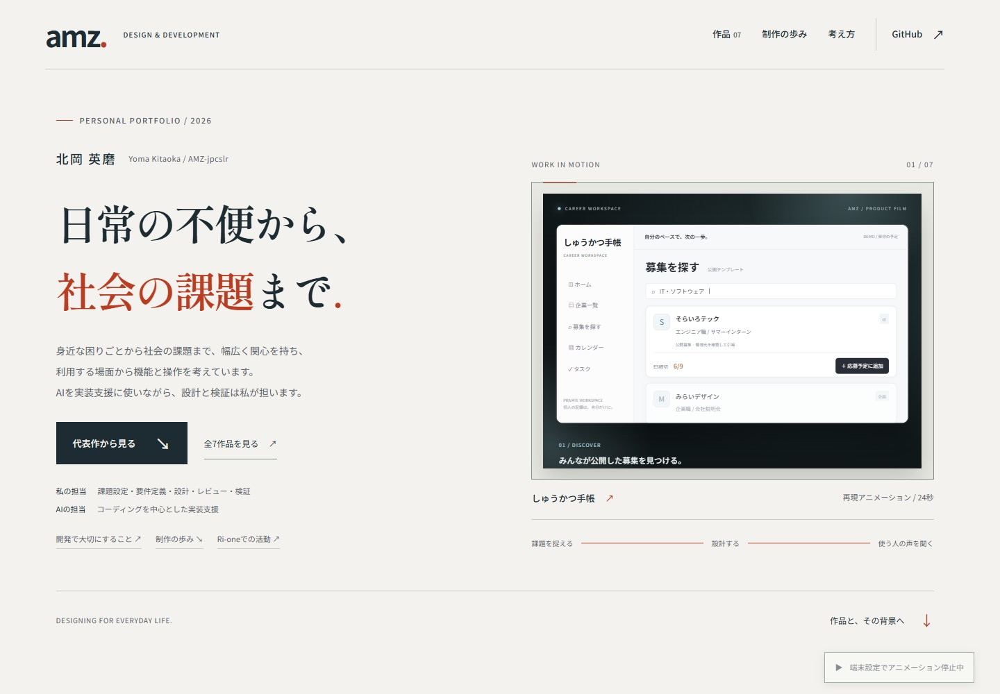
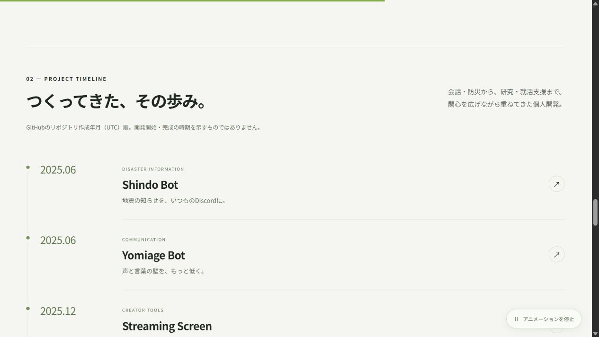
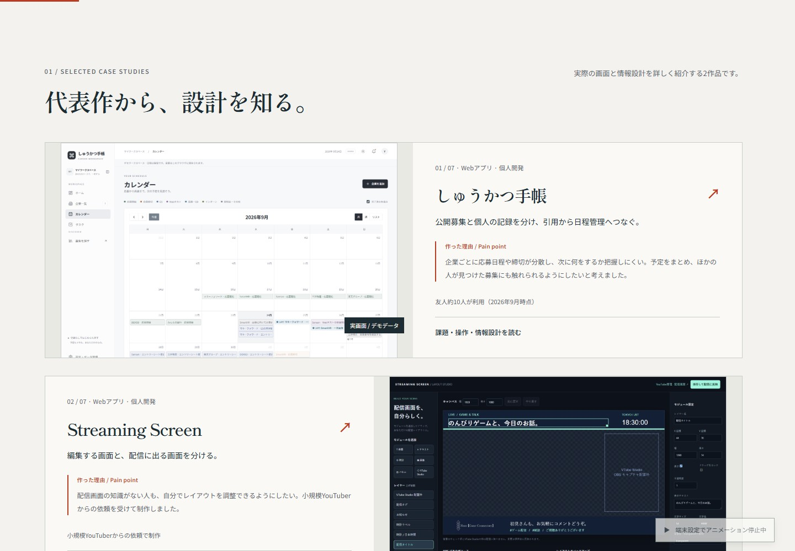
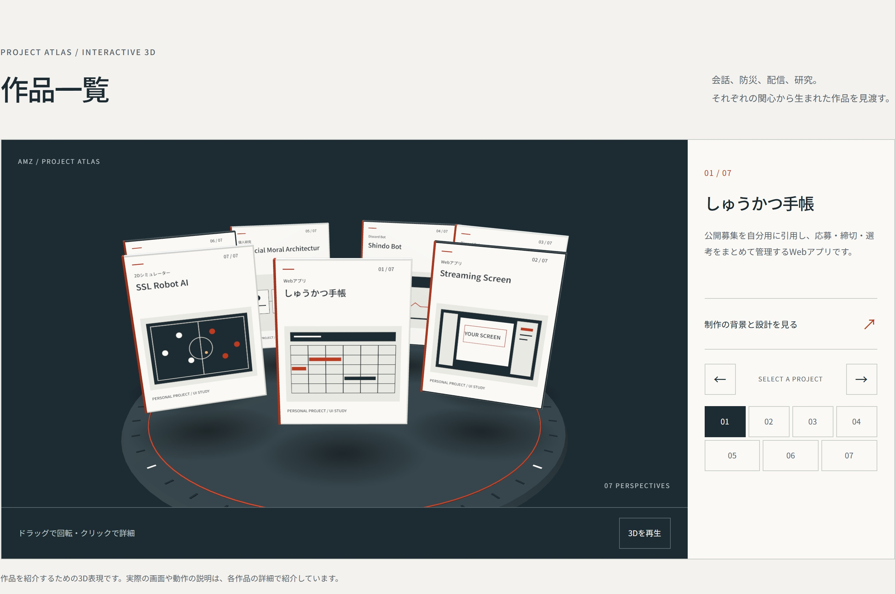

# Kitaoka Yoma / AMZ — Notes & Works

社会や身近な問題に取り組む、北岡英磨の個人開発と研究の記録です。

[公開サイト](https://portfolio-amz-jpcslr.vercel.app/) · [作品一覧](https://portfolio-amz-jpcslr.vercel.app/#works) · [開発記録](https://portfolio-amz-jpcslr.vercel.app/#records) · [GitHub](https://github.com/AMZ-jpcslr)

## サイトの構成

- 本の背表紙を押すと、8作品の短い説明がすぐに表示されます。「さらに詳しく」から詳細へ移動します。概要では作品ごとのコア機能を約12秒の短いアニメーションで紹介します。動画は読み込みません。概要の開閉もブラウザーの戻る・進むでたどれます。
- 詳細では目的・きっかけ・アプローチ・結果と現状、担当とAIの活用を紹介します。
- リポジトリの作成記録はノートのタブで選び、左のノートで概要・同じ機能アニメーション・つくった理由・得られた反応を確認できます。タブは右端に並び、ノートの右端が浮く向きで切り替わります。
- 最近の公開GitHub更新は、1件ずつ独立した付箋として表示します。新しい記録が上です。
- 理念は「課題を理解する」「試して改善する」「伝え方と研究姿勢」の3区分・9項目です。行動指針と、作品ごとの実施状況を区別しています。

詳細の動画8本は**動作イメージ（再現映像／再現イメージ）**です。実アプリの録画や実際の災害情報ではありません。作品ごとの注記を表示しています。プレビューは消音・ループで、独自の一時停止ボタンがあります。サイトの操作音はありません。

採用担当の方へのメッセージに続き、ページ末尾の本棚でサイト内を検索できます。作品に加え、自己紹介・理念・活動・作成記録・最近の開発記録・メッセージの見出しや本文、関連語をローカルで照合し、本が棚から出てくる短い演出とともに結果を表示します。検索結果は演出を待たずに開けます。外部LLM/APIへ検索語を送りません。

固定メニューは作品・記録・理念・メッセージ・検索・GitHubへの移動に対応し、狭い画面では開閉できます。キーボード・タッチ操作、動きを減らす設定に対応します。区画の短い描画と付箋の貼り付けは、画面内に十分入ってから始まり、同じ付箋を小さなスクロールのたびに貼り直しません。

作品の現在地は、作品一覧・詳細・検索結果のラベルで示します。運用・活動成果・研究を区別しています。Botを含むサービスの運用状況は作者の説明を反映しています。再現映像は稼働の証拠として扱いません。

## 作品のショートPVと詳細PV

`site/music/product-pv.js` に8作品の利用場面・機能・説明文をまとめています。概要と作成記録は約12秒のSVG/CSSによるショートPV、詳細ページは約30秒の無音MP4です。場面の導入、作品のねらい、確認できた操作と結果、機能のまとめという構成です。操作部分は `feature-flows.js` の共通定義を使います。架空データによる再現であり、実アプリの録画や稼働の証明ではありません。

- 概要は本を開いたとき、作成記録は選択した作品のPVが画面に入ったときに自動再生します。詳細動画も消音・インライン・ループで自動再生します。
- 一時停止・再生をキーボードやタッチで操作できます。画面外、バックグラウンド、概要の背後にあるPVは停止します。閲覧者が停止した状態はスクロールで解除しません。
- 「動きを減らす」設定では結果の静止画を表示し、明示的に再生を押した場合だけ動かします。ブラウザが動画の自動再生を制限した場合も再生ボタンから開始できます。
- タブ切り替え・概要の閉じる操作・ページ移動で監視を解除します。ショートPVには外部ライブラリー、動画の通信、定期タイマーを追加していません。
- 作成記録の年月はリポジトリの作成月です。PVは現在紹介している作品の説明で、作成当時の実装を再現するものではありません。

## 作成の記録

GitHubの `created_at` を基準とした**日本時間（Asia/Tokyo）の作成年月**です。開発開始・完成・リリース日ではありません。同月内も実際のタイムスタンプ順で並べます。

| 作成年月（日本時間） | 作品 |
| --- | --- |
| 2025.06 | [Shindo Bot](https://github.com/AMZ-jpcslr/Shindo_Discord_Bot) |
| 2025.07 | [Yomiage Bot](https://github.com/AMZ-jpcslr/Yomiage_Discord_Bot) |
| 2025.12 | [Streaming Screen](https://github.com/AMZ-jpcslr/Streaming-Screen) |
| 2026.01 | [SSL Robot AI](https://github.com/AMZ-jpcslr/SSL-DEMO) |
| 2026.05 | [Inspection Proxy](https://github.com/AMZ-jpcslr/ssl-inspection-prodxy) |
| 2026.09 | [Artificial Moral Architecture](https://github.com/AMZ-jpcslr/Artificial-Moral-Architecture) |
| 2026.09 | [しゅうかつ手帳](https://github.com/AMZ-jpcslr/Syukatu-Note) |
| 2026.10 | [まにあう](https://github.com/AMZ-jpcslr/train_time) |

Yomiage Botの作成日時は `2025-06-30T15:01:25Z` のため、日本時間では7月です。日付が月境界をまたぐ場合も表示を変換し、年月しか分からない資料に日単位の精度を追加しません。

## 公開GitHub更新の取得

対象は本人 `AMZ-jpcslr` と紹介している8作品の公開イベントだけです。各付箋にイベント日時と関連するGitHubリンクがあります。pushをリリースとは表示しません。最終取得日時も日本時間で表示します。

認証なしの公開APIを必要時に取得し、15分のクールダウンを設けています。利用上限・通信失敗時は最終取得日付きの保存データを表示します。APIの反映には遅延があり、完全な活動履歴ではありません。認証情報や非公開活動は使いません。

## 開発と確認

Node.js 22以上を使用します。

```sh
npm run build
npm run check
npm run dev
```

開発サーバーの既定は `http://127.0.0.1:4173/`。`site/` が現行画面のソース、`dist/` が公開出力です。`npm run build` は現行の入口と8つの詳細ページ・素材を `dist/` に反映します。Vercelは既存設定の `dist` を配信します。

`scripts/check-site.mjs` は現行8作品・出力の一致・日時変換・公開データの範囲を確認し、`scripts/check-legacy.mjs` は保持した既存7作品の資料・動画素材を確認します。旧入口は検証用の `scripts/fixtures/legacy-index.html` に保存し、公開の入口には使いません。

本文データは既存の `dist/projects.js` を土台に、`site/music/content.js` で8作品にまとめています。公開するファイルへローカル比較案、試験画面、認証情報、依存関係のキャッシュを含めません。

## 団体の表示と素材

Ri-oneの紹介は、本人の活動と個人制作のSSL試作の範囲を区別しています。[公式サイト](https://rione.org/)のロゴとURLを掲載しています。ロゴとGitHubマークの出典・ライセンスは `site/music/assets/OFFICIAL-SOURCES.md` と `site/assets/OCTICONS-LICENSE.txt` を参照してください。

<details>
<summary>以前の公開版の画面記録</summary>

以下は旧デザインの記録です。現在のサイトの画面とは異なります。






</details>

## ブラウザーでの回帰確認

PlaywrightとChromiumまたはEdgeがある環境で、ローカルサーバーを起動して `node scripts/review-book-overview.mjs` を実行できます。`PORTFOLIO_REVIEW_URL`（既定4173）、`PORTFOLIO_PLAYWRIGHT_MODULE`、`CHROMIUM_PATH`で環境を指定できます。本の概要の即時表示、8作品、概要の動画通信ゼロ、詳細の動画、履歴、フォーカス、連打、PC・モバイル相当、動きを減らす設定を確認し、結果をGit対象外の `.review/book-overview/` へ保存します。

追加した機能デモの確認は `node scripts/review-core-demos.mjs` で実行できます。同じ環境変数を使い、1440・390・320・844px幅で8作品の概要と記録タブ、停止・再開、画面外・バックグラウンド停止、動きを減らす設定と手動再生、詳細からの履歴復帰、動画通信ゼロを検証します。結果と画面写真は `.review/core-demos/` に保存します。

機能と画面の再確認、参照した8リポジトリのコミット、フローの計算例、確認できていない実接続は [機能フローの根拠](docs/feature-flow-evidence.md) を参照してください。詳細動画の現行入口は `video/recreations/product-pv.tsx`、再生成は `node video/recreations/render.mjs` です。以前の `flow-films.tsx`、`mania.tsx` と `index.tsx` は過去版の再現ソースです。

人物・駅を描き直し、利用場面から魅力を伝えるPVにした改善内容は [PVの構成と検証](docs/pv-design-review.md) にまとめています。オリジナルSVG素材は `site/music/flow-illustrations.js` です。

PVの自動再生・停止・再開・動きを減らす設定・自動再生制限の代替操作は `node scripts/review-pv-controls.mjs`、8本の全編再生とPC・スマホの場面確認は `node scripts/review-flow-films.mjs`、全720フレームのデコードは `node video/recreations/verify-flows.mjs` で確認します。
