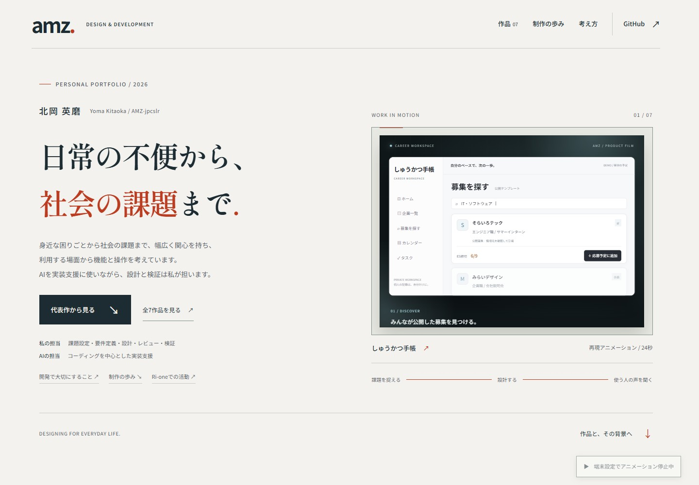
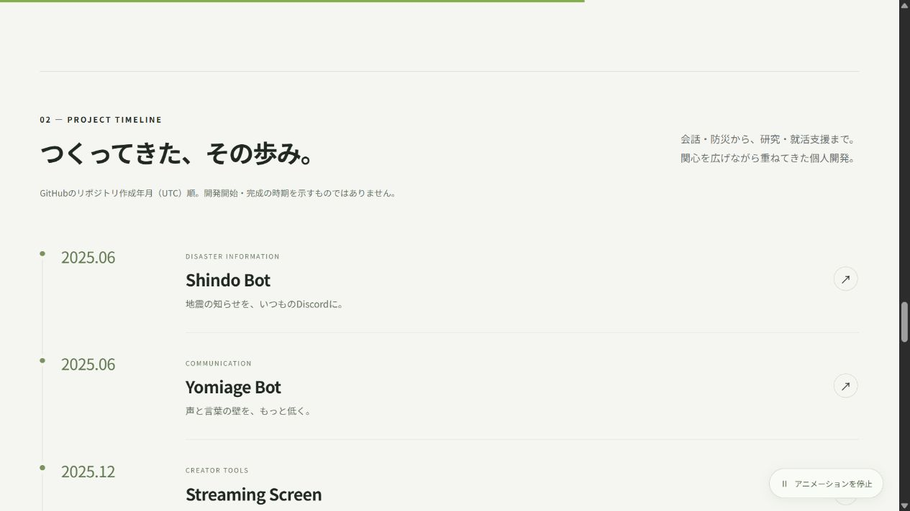
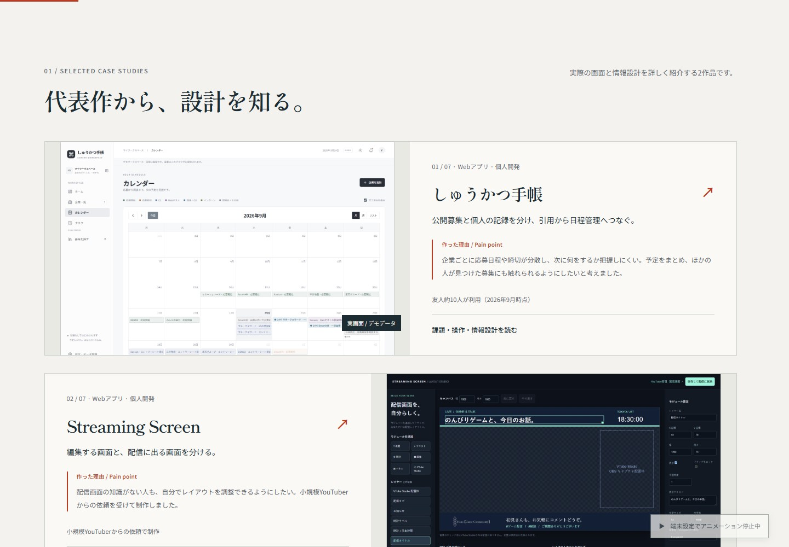
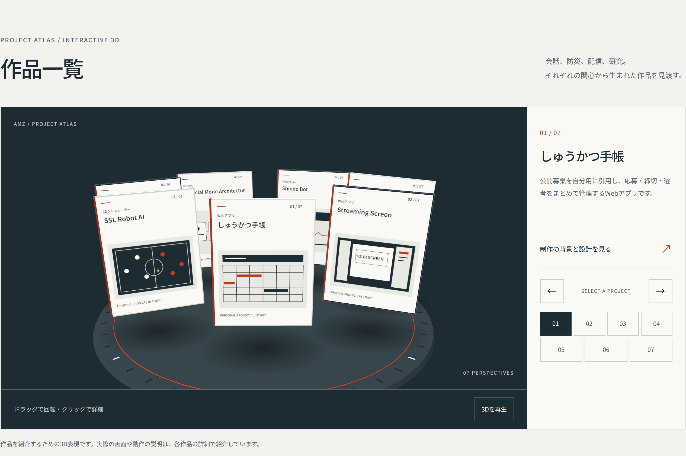

# 北岡英磨の制作ノート / Yoma Kitaoka Portfolio

社会や身近な困りごとに取り組む、北岡英磨の個人開発と研究をまとめたポートフォリオサイトです。からくり修理屋の工房と制作ノートをテーマに、8つの作品を実際の画面と操作動画で紹介しています。

[公開サイト](https://portfolio-amz-jpcslr.vercel.app/) · [作品一覧](https://portfolio-amz-jpcslr.vercel.app/#works) · [About Me](https://portfolio-amz-jpcslr.vercel.app/about/) · [GitHub](https://github.com/AMZ-jpcslr)

## サイトの構成

| ページ | URL | 内容 |
| --- | --- | --- |
| トップ | `/` | オープニング、Welcome、メッセージ、作品一覧（Works）、About Meの概要 |
| 経歴とスキル | `/about/` | 高校・大学・UBC交換留学・現在の4章の歩み、制作で使っている技術、資格、ツール使用歴 |
| 作品詳細 | `/projects/<作品>/` | 8作品それぞれの画面、課題・自分の担当・設計判断・試して分かったこと、操作動画、公開アプリとGitHubへのリンク |

### トップページ

- **オープニング**：トップページを開くたびに、からくり修理屋が登場する短いイントロを再生します（スキップできます）。動きを減らす設定のときや、作品カードへのリンクで戻ってきたときは再生しません。
- **Welcome**：懐中時計を修理するからくり修理屋のイラストです。押すと修理屋が顔を上げ、手元の歯車が回ります。
- **Message**：「社会の役に立ってから死ぬ」という抱負と、一緒につくりたいことを書いています。
- **Works**：8作品のカードです。カードから詳細ページへ移動し、「作品一覧へ」で元のカード位置に戻ります。
- **About Me**：プロフィール、スキル、ツール使用歴の概要です。続きは `/about/` にあります。

### 全ページ共通の動き

- スクロールに合わせて見出し横の歯車が回り、画面上部のラックとピニオンで読み進めた位置を示します。
- 見出しと本文は画面に入ったとき、インクで書くように表示します。
- フッターの「検印」ボタンで、制作ノートに歯車の判を押せます。
- 本文はビルド時にHTMLとして生成しているので、JavaScriptが動かない環境でも読めます。動きを減らす設定では演出を止めます。
- 以前のサイトの `#project=...` 形式のリンクは、対応する作品詳細ページへ移動します。

## 掲載作品

| 作品 | 分類 | 主な技術 | リンク |
| --- | --- | --- | --- |
| まにあう | 交通アプリ | React / TypeScript / Vite | [公開版](https://train-time-three.vercel.app/) · [GitHub](https://github.com/AMZ-jpcslr/train_time) |
| しゅうかつ手帳 | 就活カレンダー | Next.js / TypeScript / Supabase | [公開版](https://syukatu-note.vercel.app/) · [GitHub](https://github.com/AMZ-jpcslr/Syukatu-Note) |
| Streaming Screen | 配信ツール | JavaScript / Node.js / OBS | [GitHub](https://github.com/AMZ-jpcslr/Streaming-Screen) |
| Yomiage Bot | 読み上げBot | TypeScript / VOICEVOX / DeepL | [GitHub](https://github.com/AMZ-jpcslr/Yomiage_Discord_Bot) |
| Shindo Bot | 防災通知Bot | TypeScript / WebSocket / 気象データ | [GitHub](https://github.com/AMZ-jpcslr/Shindo_Discord_Bot) |
| Artificial Moral Architecture | 個人研究 | Python | [GitHub](https://github.com/AMZ-jpcslr/Artificial-Moral-Architecture) |
| Inspection Proxy | 通信検査ツール | JavaScript / Node.js / Docker | [GitHub](https://github.com/AMZ-jpcslr/ssl-inspection-prodxy) |
| SSL Robot AI | 2Dシミュレーション | Java | [GitHub](https://github.com/AMZ-jpcslr/SSL-DEMO) |

作品詳細の動画は、6作品が実アプリやCLIの操作記録です。Yomiage BotとShindo BotはDiscord上の操作を再現したもので、ユーザー名・会話・地震情報は架空です。Shindo Botの雨雲レーダー画像はBotが実際に生成した出力で、出典（気象庁・地理院タイル）をページ内に記載しています。

## 技術構成

- **静的サイト**：フレームワークは使っていません。`scripts/build.mjs` が `site/` の素材を `dist/` にコピーし、`site/notebook/*.mjs` の描画関数で10ページのHTMLを書き出します。`dist/` は毎回作り直す出力なので、Gitでは管理していません。OGP・Xカード・canonicalもここで生成します。
- **画面の動き**：素のJavaScript（`site/notebook/interactions.js`、`welcome-ink.js`）とCSSで実装しています。
- **フォント**：見出しの手書き風フォントに Klee One、本文に Noto Sans JP を使い、どちらもサイト内に置いて配信しています。
- **公開**：Vercelで `npm run build` を実行し、`dist/` を配信します（`vercel.json`）。公開URLを変える場合は環境変数 `SITE_URL` にオリジンを指定します。
- **動画**：6作品は実アプリの操作を録画したもの（`site/recordings/`）です。Yomiage BotとShindo Botの再現動画（`site/interaction-demos/`）は `video/recreations/` の Remotion で作成しています。

## ディレクトリ

```text
site/
  index.html        全ページ共通のテンプレート
  notebook/         現行サイトの描画関数・CSS・JavaScript・歯車とアイコン
  assets/           イラスト（workshop/）、作品画面（works/）、オープニング画像
  assets/fonts/     本文フォント（Noto Sans JP のサブセット）
  data/             作品詳細の本文データ
  recordings/       実アプリの操作記録動画
  interaction-demos/ Discord Botの再現動画
  fonts.css, favicon.svg, og-image.png
dist/               公開出力（npm run build で生成、Git管理外）
scripts/            ビルド、開発サーバー、検証
video/recreations/  再現動画のRemotionプロジェクト
docs/               設計メモと検証記録
```

## 開発と確認

Node.js 22以上を使用します。

```sh
npm run build   # dist/ を生成し、続けて全チェックを実行
npm run check   # 生成済みの dist/ を検証
npm run dev     # http://127.0.0.1:4173/ で dist/ を配信（PORTで変更可）
npm run lint    # ESLint
```

`npm run check`（`scripts/check-notebook.mjs`）は、10ページのメタデータ、見出し、画像の代替テキスト、ローカル素材とページ内リンクの存在、ソースと出力の一致を確認します。

再現動画は `node video/recreations/render-interactions.mjs` で再生成します。`REMOTION_BROWSER_EXECUTABLE` にChromiumを指定し、`ONLY=voice` などで1作品、`STILL=1` で主要画面のみを生成できます。

## 素材とライセンス

- フォント：Klee One、Noto Sans JP（SIL Open Font License）。`site/assets/workshop/Klee-One-OFL.txt` と `site/assets/fonts/OFL-Noto-Sans-JP.txt` を同梱しています。
- ツールのアイコン：Devicon の SVG をそのまま使用しています（`site/notebook/icons/LICENSE.txt`）。
- GitHubマーク：`site/assets/OCTICONS-LICENSE.txt` を参照してください。
- 各製品名・ロゴはそれぞれの権利者に帰属します。

<details>
<summary>以前の公開版の画面記録</summary>

以下は以前のデザインの記録です。現在のサイトの画面とは異なります。






</details>
