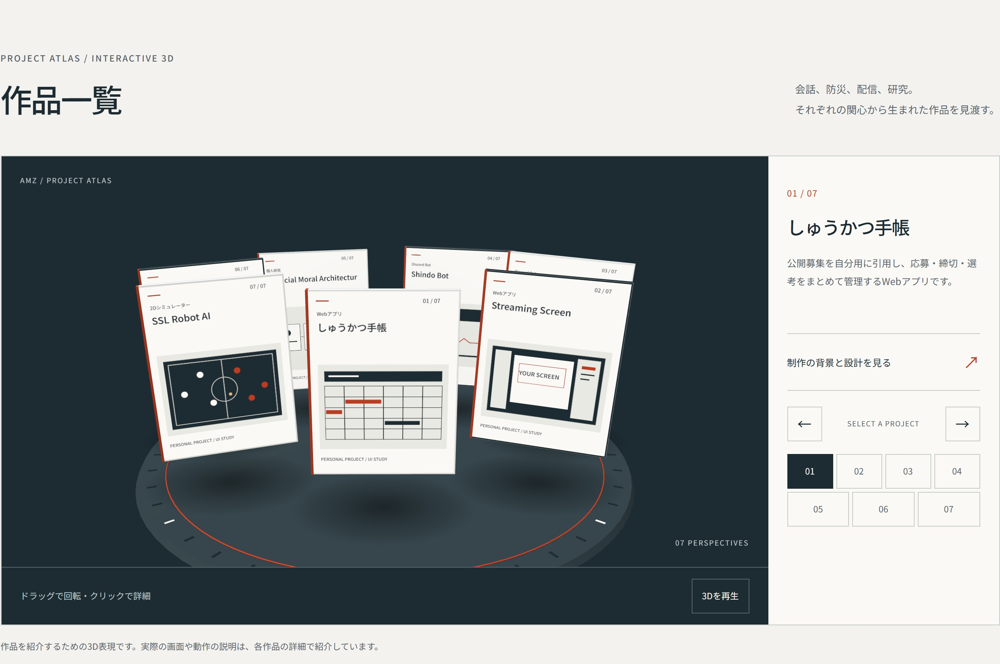

# 3D作品ギャラリー

2026年10月15日。ローカルUser Skill「3d-web-experience」に沿って実装しました。以下はローカルでの実装・検証記録です。同日、プレビュー確認後の承認を受けて本番サイトへ公開しました。

## 表現と操作

既存のインク色・朱色・紙の色を引き継ぎ、7作品を円形の台座上に並ぶ立体パネルにしました。パネルはわずかに浮遊し、選択した作品が手前に回り込みます。パネルの絵は各分野を表す模式的なイラストで、実アプリの画面ではありません。

- ドラッグ：パネルの並びを回転し、離した位置に近い作品を選択します。
- パネルのクリック：クリックした作品の詳細を直接開きます。
- 作品番号、前後ボタン：表示する作品を選択します。
- 3D領域にフォーカスした状態の左右キー：前後の作品へ移動します。Home／Endは先頭／末尾へ移動します。
- 3D領域でEnter／Space：選択中の作品詳細を開きます。
- 「制作の背景と設計を見る」：既存の作品詳細へ進みます。
- 「3Dを一時停止」：3Dだけ停止します。全体の停止ボタンや端末の設定とも連動します。

見出しは「作品一覧」としています。代表作、通常の一覧、利用状況、担当・AI活用の記述も維持しています。各作品の再現PVは[Remotion版](remotion-films-2026-10-15.md)へ更新しました。

## 実装と負荷への配慮

[Three.js](https://threejs.org/) 0.186.1をローカル配信します。Reactなどへの移行は行っていません。ライブラリとMITライセンスは `dist/vendor/three/` にあります。2つのライブラリファイルは合計約809KB（圧縮転送前）です。

- 3D領域が画面に近づいてから、ライブラリを動的に読み込みます。
- ロード中は静止画と準備中の表示を出します。
- 低ポリゴンの形状をコードで生成し、大きなモデルや外部画像を読み込みません。高価なリアルタイムの影の代わりに小さな影用テクスチャを使います。
- パネル用のCanvasテクスチャを1024 × 1328pxにしました。従来の512 × 664pxに対して縦横2倍です。傾いた面でも文字を読みやすくするため、GPUの対応範囲内で異方性フィルタリングを使います。
- モバイルでもアンチエイリアスを有効にし、斜めのパネルの縁のぎざつきを抑えます。解像度とフレーム数の上限は維持しています。
- PCではDPR上限2・60fps、スマートフォン相当の幅または粗いポインターではDPR上限1.5・30fpsとしています。描画画素数もPCで240万・モバイルで55万を上限とし、大きな画面ではDPRを下げます。これは設定上の上限で、端末での実測フレームレートではありません。
- リサイズ時にも描画解像度を調整します。画面外、非表示タブ、詳細表示中、一時停止中には継続描画しません。
- 「動きを減らす」設定では立体を静止表示し、明示的な作品選択には即座に切り替わります。
- WebGLを使えない場合、ライブラリを読み込めない場合、描画コンテキストを失った場合は、実際の3D描画から撮影した静止画へ切り替えます。作品選択と詳細リンクは引き続き使えます。
- タッチ操作では縦方向のスクロールを維持し、ホイールによるズームでスクロールを奪う操作も追加していません。

## 表示・操作の確認

Microsoft Edgeの自動ブラウザで確認しました。実機のスマートフォンによる性能測定ではありません。

- 1440・1024・768・760・390・320pxで全7作品を選択し、タイトルと詳細リンクの一致、選択状態が1件であること、横にはみ出さないことを確認しました。
- 既存の一覧は2列の上端と高さが揃い、全7作品の詳細も開閉できます。
- 再生中は実際の描画画像が変化し、一時停止中は同一の画像が保たれることを確認しました。
- ドラッグ、左右・Home・Endキー、Enterでの詳細表示、Escapeでの終了、元のリンクへのフォーカス復帰を確認しました。
- 個別停止・全体停止・画面外・詳細表示中・動きを減らす設定への連動を確認しました。
- DPR 3のスマートフォン相当で描画DPR1.5、PCのDPR 2では2になりました。幅760pxでは画素数上限により約1.36まで下がり、幅390pxへのリサイズ後には約1.5になることを確認しました。
- 全7作品について、手前のパネルをクリックして対応する詳細URLが開くこと、ドラッグでは詳細に移動しないことを確認しました。
- WebGL無効、ライブラリ読み込み失敗、コンテキスト喪失をそれぞれ再現し、静止画へ切り替わることを確認しました。
- 通常利用の確認ではブラウザのJavaScript実行エラーはありませんでした。ビルド・既存チェックも通過しています。

## プレビュー

- [3Dギャラリー](http://127.0.0.1:4180/#spatial)
- [サイトのトップ](http://127.0.0.1:4180/#top)

起動する場合は、PowerShellで次を実行します。

```powershell
$env:PORT='4180'
node scripts/serve.mjs
```



2026年10月15日、コミット `375991e` をGitHubへプッシュし、VercelのProductionデプロイ成功を確認しました。[本番サイト](https://portfolio-amz-jpcslr.vercel.app/#spatial)でも3Dからの詳細表示、全7本のPV、停止とシーク、モバイル幅での表示を確認しています。

参考：[WebGLRendererの公式ドキュメント](https://threejs.org/docs/pages/WebGLRenderer.html)、[Raycasterの公式ドキュメント](https://threejs.org/docs/pages/Raycaster.html)。
